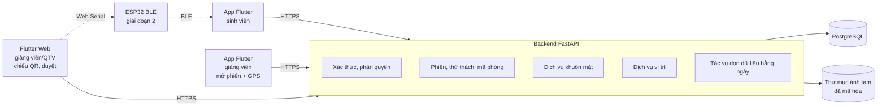
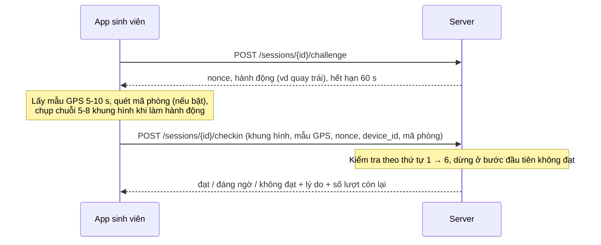
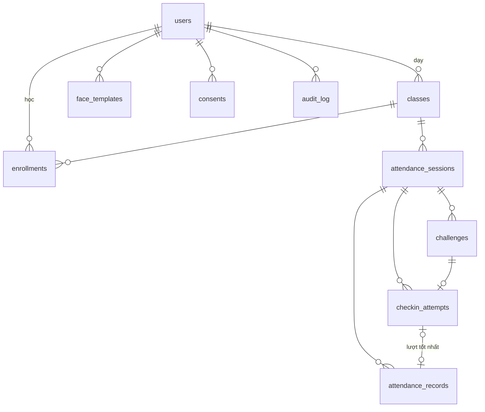

# Đặc tả thiết kế: Ứng dụng điểm danh sinh viên bằng nhận diện khuôn mặt và định vị GPS

Nov 10, 2026 · @Thái Sơn · Bản 2 (sửa luồng xử lý, CSDL, API; xem Phụ lục A)

## 1. Tổng quan

Đề tài xây dựng một ứng dụng điểm danh cho một khoa (vài trăm sinh viên), xác thực đồng thời bằng nhận diện khuôn mặt và định vị GPS, để sinh viên khó điểm danh hộ hoặc điểm danh từ xa.

**Bài toán.** Điểm danh bằng cách gọi tên hoặc ký giấy tốn thời gian của buổi học và dễ gian lận. Ứng dụng này cho phép sinh viên tự điểm danh bằng điện thoại cá nhân trong thời gian giảng viên mở phiên, và hệ thống kiểm tra hai điều: đúng người (khuôn mặt) và đúng nơi (GPS).

**Người dùng**

| Vai trò | Việc chính |
| --- | --- |
| Sinh viên | Đồng ý xử lý dữ liệu, đăng ký khuôn mặt một lần, điểm danh trong mỗi phiên, xem lịch sử chuyên cần của mình |
| Giảng viên | Mở và đóng phiên, chiếu mã phòng (khi bật), xem danh sách theo thời gian thực, duyệt lượt đáng ngờ, chỉnh kết quả, duyệt khuôn mặt sinh viên lớp mình |
| Quản trị viên | Quản lý tài khoản, lớp, danh sách sinh viên (nhập CSV), duyệt khuôn mặt, xóa dữ liệu khuôn mặt theo yêu cầu, xuất báo cáo |

**Tiêu chí thành công**

- Luồng đầy đủ chạy được trong một lớp thật: đăng ký, mở phiên, điểm danh, duyệt lượt đáng ngờ, đóng phiên, xem báo cáo.
- Nhận diện khuôn mặt có FAR (nhận nhầm người lạ) thấp và FRR (từ chối nhầm chính chủ) đủ thấp để sinh viên ít phải thử lại. Giá trị mục tiêu cụ thể chốt sau khi có số liệu ở mục 10.
- Chống được các cách gian lận phổ biến: dùng ảnh hoặc video của người khác, điểm danh từ xa, điểm danh hộ trên tài khoản người khác, phát lại gói tin cũ.
- Có số liệu đo thực tế về độ lệch GPS trong phòng học để chọn bán kính, thay vì chọn theo cảm tính.

## 2. Phạm vi và các quyết định đã chốt

Phạm vi là một sản phẩm thử nghiệm cho một khoa, với GPS là lớp xác thực vị trí bắt buộc và khuôn mặt là lớp xác thực danh tính bắt buộc; kết quả cuối cùng ghép hai lớp theo bảng quyết định ở mục 4.4.

| Chủ đề | Quyết định |
| --- | --- |
| Mục tiêu | Sản phẩm thử nghiệm dùng thật cho một lớp hoặc một khoa |
| Quy mô | Một khoa (vài trăm sinh viên), 3 vai trò |
| Luồng điểm danh | Giảng viên mở phiên theo buổi học (có hạn đóng), sinh viên tự điểm danh bằng điện thoại cá nhân, tối đa 5 lượt thử mỗi phiên |
| Đăng ký khuôn mặt | Sinh viên tự chụp, quản trị viên hoặc giảng viên của lớp đối chiếu ảnh thẻ sinh viên rồi duyệt |
| Kiến trúc nhận diện | Kết hợp: app sàng lọc chất lượng ảnh, server quyết định liveness và đối sánh |
| Chọn mô hình | Chốt mô hình **trước** khi cho sinh viên đăng ký thật (cổng kiểm tra cuối giai đoạn 2). Embedding gắn tên mô hình; đổi mô hình sau đó đồng nghĩa với đăng ký lại |
| Vị trí | Tâm lấy từ điện thoại giảng viên khi mở phiên, bán kính thích ứng theo sai số, có trần sai số |
| Kỹ thuật GPS chạy thật | Lấy nhiều mẫu, lọc theo độ chính xác, lấy trung vị. Bộ lọc Kalman và đo tương đối chỉ đánh giá offline trên dữ liệu mẫu thô (mục 10), không chạy trong hệ thống |
| Xác nhận đúng phòng | Giai đoạn 1 (tùy chọn): mã QR xoay vòng. Giai đoạn 2 (mở rộng): ESP32 phát BLE, cắm vào laptop giảng viên |
| Giao diện | App Flutter (Android, iOS) cho cả 3 vai trò; bản Flutter Web cho giảng viên và quản trị viên trên laptop (chiếu QR, gửi mã xuống ESP32, duyệt, báo cáo). Không làm web cho sinh viên |
| Công nghệ | Flutter, backend Python (FastAPI), PostgreSQL, mô hình ONNX trên CPU |
| Triển khai | Phát triển trên laptop, chạy thử trên VPS không GPU (khoảng 4 vCPU, 8 GB RAM) |

**Ngoài phạm vi (giai đoạn đầu):** phần cứng điểm danh chuyên dụng, tích hợp hệ thống quản lý đào tạo, nhận diện nhiều người trong một ảnh, web cho sinh viên, điểm danh khi không có mạng, trạng thái "đi muộn" tự động (giảng viên có thể mở thêm phiên hoặc chỉnh tay), thông báo đẩy.

## 3. Kiến trúc hệ thống

App chỉ chụp ảnh, lấy GPS và sàng lọc nhẹ; mọi quyết định về khuôn mặt, liveness, vị trí và mã phòng do backend đưa ra, vì app có thể bị sửa.



| Thành phần | Nhiệm vụ | Phụ thuộc vào |
| --- | --- | --- |
| App Flutter | Giao diện 3 vai trò, chụp chuỗi khung hình, lấy mẫu GPS, đọc cờ mock location (Android), quét QR/BLE | Backend qua HTTPS |
| Flutter Web | Giảng viên chiếu QR, gửi mã xuống ESP32, duyệt; quản trị viên quản lý và báo cáo | Backend qua HTTPS |
| Xác thực và phân quyền | Đăng nhập, access token ngắn hạn + refresh token, kiểm tra vai trò và phạm vi lớp | PostgreSQL |
| Phiên điểm danh | Tạo, đóng (thủ công hoặc hết hạn), chốt tâm, cấp thử thách, sinh mã phòng | PostgreSQL |
| Dịch vụ khuôn mặt | Phát hiện, căn chỉnh, chất lượng, kiểm tra hành động, anti-spoofing, embedding, đối sánh 1-1 | Mô hình ONNX |
| Dịch vụ vị trí | Gộp mẫu GPS, Haversine, ngưỡng thích ứng, phát hiện bước nhảy, phát hiện tâm lệch | Dữ liệu phiên, đa giác khuôn viên (file GeoJSON) |
| Tác vụ dọn dữ liệu | Xóa ảnh bằng chứng quá hạn, ảnh đăng ký đã duyệt, thử thách cũ | PostgreSQL, thư mục ảnh |
| PostgreSQL | Lưu người dùng, lớp, phiên, embedding, lượt thử, kết quả, nhật ký | Không |
| ESP32 (giai đoạn 2) | Phát mã phòng xoay vòng qua BLE advertising | Laptop giảng viên (USB) |

Dịch vụ khuôn mặt và dịch vụ vị trí là hàm thuần: nhận dữ liệu vào, trả điểm số và lý do, không truy cập CSDL hay HTTP, nên kiểm thử độc lập được và dùng lại được cho các thí nghiệm ở mục 10.

Suy luận ONNX chạy trong thread pool có giới hạn số luồng bằng số core (semaphore). Với khoảng 60 sinh viên trong vài phút, cách này đủ; không cần hàng đợi riêng (Celery, Redis).

## 4. Luồng nghiệp vụ

Có sáu luồng: chuẩn bị tài khoản, đăng ký khuôn mặt, mở phiên, điểm danh, duyệt và đóng phiên, xóa dữ liệu.

### 4.1 Chuẩn bị tài khoản và lớp

1. Quản trị viên nhập danh sách sinh viên, giảng viên, lớp và danh sách lớp bằng file CSV (hoặc tạo tay).
2. Tài khoản được tạo với mật khẩu tạm và cờ "phải đổi mật khẩu"; lần đăng nhập đầu tiên bắt buộc đổi.
3. Quên mật khẩu: quản trị viên đặt lại mật khẩu tạm (không làm gửi email ở giai đoạn đầu).

### 4.2 Đăng ký khuôn mặt

1. Sinh viên đăng nhập, đọc và đồng ý nội dung xử lý dữ liệu sinh trắc học (mục 8). Lần đồng ý được lưu kèm phiên bản văn bản. Chưa đồng ý thì không đăng ký được.
2. App hướng dẫn chụp 3 đến 5 ảnh (nhìn thẳng, hơi quay trái, hơi quay phải) và sàng lọc chất lượng.
3. Server kiểm tra từng ảnh: đúng một khuôn mặt, chất lượng đạt, anti-spoofing đạt, các ảnh cùng một người (độ tương đồng giữa các ảnh vượt ngưỡng). Không đạt thì trả lý do để chụp lại.
4. Server tính embedding từng ảnh, lấy trung bình rồi chuẩn hóa thành một vector, mã hóa và lưu mẫu ở trạng thái **chờ duyệt**, kèm tên mô hình. Ảnh lưu tạm (đã mã hóa) để người duyệt đối chiếu.
5. Quản trị viên, hoặc giảng viên của một lớp mà sinh viên đó học, đối chiếu ảnh với ảnh thẻ sinh viên rồi **duyệt** hoặc **từ chối** (kèm lý do). Mọi lần xem ảnh và duyệt đều ghi nhật ký.
6. Sau khi duyệt hoặc từ chối, ảnh đăng ký bị xóa, chỉ giữ embedding (với mẫu đã duyệt).
7. Bị từ chối: sinh viên thấy lý do và đăng ký lại từ bước 2.

**Đăng ký lại khi đã có mẫu đã duyệt** (đổi diện mạo, mẫu cũ hay bị từ chối nhầm): mẫu mới ở trạng thái chờ duyệt, mẫu cũ vẫn dùng để điểm danh. Khi mẫu mới được duyệt, mẫu cũ chuyển sang **thu hồi** và embedding cũ bị xóa. Mỗi sinh viên có tối đa một mẫu đã duyệt và một mẫu chờ duyệt (ràng buộc ở CSDL, mục 9).

**Đổi mô hình:** mẫu có tên mô hình khác mô hình đang chạy được coi là không hợp lệ; sinh viên phải đăng ký lại. Vì vậy mô hình phải chốt trước khi đăng ký thật.

### 4.3 Giảng viên mở phiên

1. Trên điện thoại, giảng viên chọn lớp, thời hạn (mặc định 10 phút) và bán kính cơ sở r₀ (mặc định theo cấu hình, mục 6.3).
2. App lấy mẫu GPS liên tục tối đa khoảng 20 giây, giữ các mẫu có độ chính xác ≤ σ_max_gv (mặc định 20 m). Khi có ít nhất 5 mẫu đạt thì gửi lên; quá thời gian vẫn chưa đủ thì báo chờ hoặc đổi chỗ (gần cửa sổ, hành lang).
3. Server chốt tâm bằng trung vị từng tọa độ của các mẫu đạt, sai số tâm σ_gv bằng trung vị độ chính xác. Server kiểm tra tâm nằm trong đa giác khuôn viên; ngoài đa giác thì từ chối mở phiên (giảng viên đang ở ngoài trường thì không có lý do mở).
4. Server kiểm tra lớp không có phiên khác đang mở, tạo phiên, sinh khóa bí mật mã phòng, và **tạo sẵn kết quả "vắng" cho mọi sinh viên trong lớp**. Nhờ vậy danh sách thời gian thực hiện đủ cả lớp và báo cáo không phải tự suy ra người vắng.
5. Khi bật lớp phụ trợ, giảng viên mở Flutter Web trên laptop (cùng tài khoản), chọn phiên đang mở để chiếu mã QR hoặc gửi mã xuống ESP32 (mục 7.2).

### 4.4 Sinh viên điểm danh



**Khi xin thử thách** server kiểm tra trước: phiên đang mở, sinh viên thuộc lớp, có mẫu khuôn mặt đã duyệt với mô hình hiện tại, chưa có kết quả "có mặt", còn lượt thử. Thiếu điều kiện nào thì báo ngay, không cấp thử thách. Mỗi lần xin thử thách tính là một lượt thử, kể cả khi sau đó không gửi lên (chống xin thử thách liên tục để chọn hành động dễ).

**Khi nhận lượt điểm danh**, server kiểm tra theo thứ tự từ rẻ đến đắt và dừng ở bước đầu tiên không đạt:

| Bước | Kiểm tra | Không đạt khi |
| --- | --- | --- |
| 1. Phiên và quyền | Phiên còn mở theo giờ server nhận request; sinh viên thuộc lớp | Phiên đã đóng hoặc hết hạn |
| 2. Thử thách | Nonce thuộc đúng sinh viên và phiên, chưa dùng, chưa hết hạn. Đánh dấu đã dùng ngay tại bước này | Nonce sai, đã dùng, hết hạn |
| 3. Mã phòng (nếu phiên bật) | Mã khớp cửa sổ thời gian hiện tại hoặc cửa sổ ngay trước | Mã sai hoặc thiếu |
| 4. Vị trí | Gộp mẫu GPS, tính d và r (mục 6) | σ_sv > σ_max_sv hoặc d > 2r |
| 5. Liveness | Chất lượng khung hình, đúng hành động được yêu cầu, anti-spoofing | Khung hình kém, sai hành động, phát hiện giả mạo |
| 6. Khuôn mặt | Đối sánh 1-1 **mọi khung hình có mặt** với mẫu đã duyệt; điểm = trung vị, khung thấp nhất cũng phải trên ngưỡng "sát ngưỡng" | Điểm dưới ngưỡng |

Request dừng ở bước 1 hoặc 2 chỉ trả lỗi HTTP, không ghi lượt thử (vì chưa xác định được thử thách hợp lệ). Từ bước 3 trở đi, mọi lượt đều được ghi kèm bước dừng lại.

**Bảng quyết định** (chỉ áp dụng khi qua cả 6 bước):

| Khuôn mặt \ Vị trí | d ≤ r | r < d ≤ 2r |
| --- | --- | --- |
| Đạt (điểm ≥ ngưỡng chấp nhận) | **Có mặt** | Đáng ngờ |
| Sát ngưỡng (giữa ngưỡng nghi ngờ và ngưỡng chấp nhận) | Đáng ngờ | Đáng ngờ |

Các dấu hiệu sau biến kết quả "có mặt" thành **đáng ngờ** (ghi vào danh sách cờ):

- App báo mock location.
- Phát hiện bước nhảy vị trí bất thường (mục 6.2).
- Cùng `device_id` đã được dùng cho sinh viên khác trong cùng phiên.
- Nhiều sinh viên gửi cùng một mã phòng trong vài giây từ cùng địa chỉ IP (chỉ khi bật mã phòng).

**Cập nhật kết quả.** Mọi lượt gửi lên được ghi vào `checkin_attempts`. Kết quả cuối `attendance_records` chỉ được **nâng hạng**: vắng < đáng ngờ < có mặt. Một lượt không đạt hoặc đáng ngờ không bao giờ hạ một kết quả "có mặt" đã có. Khi giảng viên đã quyết định tay, hệ thống không tự ghi đè nữa.

**Lý do trả về cho sinh viên** dùng thông điệp cụ thể, ví dụ: "Thiếu sáng", "Chưa quay sang trái", "GPS chưa đủ chính xác, hãy bật Wi-Fi và thử lại", "Bạn đang ở xa vị trí lớp học". Server không trả điểm số thô, để tránh dò ngưỡng.

### 4.5 Giảng viên theo dõi, duyệt và đóng phiên

- Danh sách cập nhật bằng cách hỏi lại server mỗi 3 đến 5 giây: số có mặt, số đáng ngờ, số chưa điểm danh, kèm cờ và lý do.
- Mỗi lượt đáng ngờ kèm ảnh khung hình tốt nhất (giữ 30 ngày), điểm khuôn mặt, khoảng cách d, bán kính r, độ chính xác GPS và danh sách cờ. Giảng viên chọn **duyệt có mặt** hoặc **từ chối**.
- **Tâm lệch:** khi có ít nhất 5 lượt đã đạt bước khuôn mặt và hơn 70 % trong số đó lệch cùng một phía (hướng nằm trong ±45° quanh hướng trung bình) với trung vị d > r₀, app báo giảng viên. Giảng viên bấm "tính lại tâm": server lấy trung vị của tâm cũ và vị trí các sinh viên đã qua khuôn mặt, lưu tâm gốc, rồi chấm lại vị trí cho các lượt chưa có quyết định tay. Việc chấm lại chỉ được nâng hạng, không hạ.
- **Đóng phiên:** giảng viên bấm đóng, hoặc phiên tự coi là đóng khi quá hạn (mọi request đều so với `expires_at`, không cần cron). Sau khi đóng, sinh viên không điểm danh được nữa; ai còn "vắng" thì giữ nguyên.
- **Sau khi đóng:** giảng viên vẫn chỉnh được kết quả (có mặt, vắng, vắng có phép, từ chối), kèm ghi chú. Mọi chỉnh sửa ghi vào nhật ký với giá trị trước và sau.

### 4.6 Xóa dữ liệu khuôn mặt

- Sinh viên tự xóa trong app (`DELETE /me/face`): mọi mẫu khuôn mặt chuyển sang thu hồi, embedding và ảnh liên quan bị xóa ngay, ghi nhật ký. Sau đó sinh viên không điểm danh bằng khuôn mặt được cho đến khi đăng ký lại; giảng viên điểm danh tay cho trường hợp này.
- Quản trị viên cũng xóa được theo yêu cầu bằng văn bản (`DELETE /admin/users/{id}/face`).
- Khi tài khoản bị vô hiệu hóa (thôi học, ra trường), dữ liệu khuôn mặt bị xóa cùng.
- Kết quả điểm danh và điểm số đã lưu được giữ lại vì là dữ liệu chuyên cần, không phải dữ liệu sinh trắc.

### 4.7 Danh sách màn hình

Cột "Endpoint" chỉ ra màn hình gọi API nào (mục 9.3, 9.5), để app và backend làm song song được.

**Chung (app và web)**

| Màn hình | Nội dung | Endpoint |
| --- | --- | --- |
| Đăng nhập | Email, mật khẩu; báo lỗi sai thông tin hoặc bị khóa tạm | POST /auth/login |
| Đổi mật khẩu bắt buộc | Hiện khi `must_change_password = true`; không vào được màn khác trước khi đổi | POST /auth/change-password |

**Sinh viên (app điện thoại)**

| Màn hình | Nội dung | Endpoint |
| --- | --- | --- |
| Trang chủ | Thẻ trạng thái khuôn mặt (chưa đăng ký / chờ duyệt / đã duyệt / bị từ chối); danh sách lớp, lớp nào đang có phiên mở thì có nút "Điểm danh" và đồng hồ đếm ngược | GET /me, GET /me/classes |
| Đồng ý dữ liệu | Văn bản đồng ý (mục 8), ô đánh dấu, nút đồng ý; hiện trước lần đăng ký đầu và khi có phiên bản mới | POST /me/consent |
| Đăng ký khuôn mặt | Hướng dẫn; camera có khung oval, chụp lần lượt thẳng, trái, phải; sàng lọc tại chỗ; màn kết quả "đã gửi, chờ duyệt" hoặc lý do từng ảnh không đạt | POST /faces/enroll |
| Khuôn mặt của tôi | Trạng thái, lý do từ chối, nút đăng ký lại, nút xóa dữ liệu (hộp xác nhận nêu hậu quả) | GET /me, DELETE /me/face |
| Điểm danh | Một màn theo từng bước: (1) xin thử thách; (2) quét QR hoặc BLE nếu phiên bật; (3) lấy GPS, hiện độ chính xác hiện tại và gợi ý khi chưa đạt; (4) camera với chỉ dẫn hành động ("Quay đầu sang trái") và vòng đếm 60 giây; (5) gửi, chờ, hiện kết quả. Không đạt: hiện lý do, số lượt còn lại, nút thử lại | POST /sessions/{id}/challenge, POST /sessions/{id}/checkin |
| Lịch sử chuyên cần | Theo lớp: từng buổi và trạng thái; tổng có mặt / vắng | GET /me/attendance |
| Quyền truy cập | Hiện khi người dùng từ chối quyền camera, vị trí hoặc Bluetooth: giải thích lý do cần, nút mở cài đặt hệ thống | Không |

**Giảng viên (app điện thoại)**

| Màn hình | Nội dung | Endpoint |
| --- | --- | --- |
| Lớp của tôi | Danh sách lớp; lớp đang có phiên thì vào thẳng màn "Phiên đang chạy" | GET /me/classes |
| Mở phiên | Chọn thời hạn, r₀, bật mã phòng; thanh trạng thái GPS (số mẫu đạt, độ chính xác); nút mở chỉ bật khi đủ mẫu | POST /sessions |
| Phiên đang chạy | Bộ đếm có mặt / đáng ngờ / chưa điểm danh; danh sách lọc theo trạng thái, tự làm mới 3-5 giây; dải cảnh báo "tâm có thể lệch" kèm nút tính lại tâm; nút đóng phiên | GET /sessions/{id}/records, POST /sessions/{id}/recenter, POST /sessions/{id}/close |
| Chi tiết sinh viên trong phiên | Ảnh bằng chứng (nếu có), điểm khuôn mặt, d, r, độ chính xác, cờ, danh sách các lượt; nút đặt trạng thái (có mặt, vắng, vắng có phép, từ chối) kèm ghi chú | GET /attempts/{id}/evidence, PATCH /sessions/{id}/records/{student_id} |
| Lịch sử phiên | Các phiên đã qua của lớp; mở lại để chỉnh kết quả | GET /classes/{id}/sessions |
| Duyệt khuôn mặt | Danh sách chờ duyệt của sinh viên lớp mình; xem ảnh cạnh thông tin sinh viên; duyệt hoặc từ chối kèm lý do | GET /faces/pending, GET /faces/{id}/photos, POST /faces/{id}/review |

**Giảng viên (Flutter Web trên laptop)**

| Màn hình | Nội dung | Endpoint |
| --- | --- | --- |
| Chiếu mã phòng | Chọn phiên đang mở; QR toàn màn hình, tự đổi mỗi 30 giây, kèm tên lớp và đồng hồ phiên | GET /sessions/{id}/room-token |
| Gửi mã ESP32 (giai đoạn 2) | Nút kết nối cổng USB (Web Serial), trạng thái thiết bị, mã đang phát | GET /sessions/{id}/room-token |
| Phiên đang chạy, duyệt khuôn mặt, lịch sử phiên | Giống bản app, bố cục rộng | Như trên |
| Báo cáo lớp | Bảng sinh viên × số buổi có mặt / vắng / có phép; nút xuất CSV | GET /reports/classes/{id} |

**Quản trị viên (Flutter Web)**

| Màn hình | Nội dung | Endpoint |
| --- | --- | --- |
| Người dùng | Tìm kiếm, lọc theo vai trò; tạo, sửa, đặt lại mật khẩu, vô hiệu hóa, xóa dữ liệu khuôn mặt | /admin/users, DELETE /admin/users/{id}/face |
| Lớp | Danh sách lớp theo học kỳ; sửa giảng viên phụ trách; danh sách sinh viên của lớp, thêm / bớt | /admin/classes, /admin/enrollments |
| Nhập CSV | Chọn loại file, tải lên, xem trước kết quả kiểm tra từng dòng, xác nhận nhập | POST /admin/import |
| Duyệt khuôn mặt | Như giảng viên nhưng thấy mọi sinh viên | Như trên |
| Báo cáo | Chọn lớp, xem và xuất CSV | GET /reports/classes/{id} |
| Nhật ký | Lọc theo người thực hiện, hành động, thời gian | GET /admin/audit-log |

## 5. Nhận diện khuôn mặt và chống giả mạo

Server so khớp khuôn mặt 1-1 với chính tài khoản đang điểm danh, sau khi đã xác nhận ảnh là người thật và đúng hành động được yêu cầu.

### 5.1 Đường xử lý trên server

1. **Phát hiện mặt và căn chỉnh**: RetinaFace hoặc YuNet (MTCNN chậm hơn trên CPU); cắt và xoay mặt về 112×112 px theo 5 điểm mốc.
2. **Kiểm tra chất lượng**: đúng một khuôn mặt, mặt rộng ≥ 100 px, đủ sáng (độ sáng trung bình vùng mặt), đủ nét (phương sai Laplacian), góc quay trong ngưỡng.
3. **Kiểm tra hành động**: ước lượng góc quay đầu (yaw) trên chuỗi khung hình từ 5 điểm mốc; hành động "quay trái/phải" đạt khi yaw đổi dấu và vượt ngưỡng (khoảng 20°) rồi quay về. Hành động "chớp mắt" cần landmark mắt chi tiết (bộ 106 điểm của InsightFace) nên làm sau.
4. **Anti-spoofing**: mô hình phân loại người thật / giả mạo (ví dụ dòng MiniFASNet, chạy ONNX) trên 2 đến 3 khung hình; lấy điểm thấp nhất.
5. **Trích xuất embedding**: ArcFace, FaceNet hoặc MobileFaceNet dạng ONNX trên CPU (InsightFace hoặc facenet-pytorch xuất ONNX).
6. **Đối sánh 1-1**: cosine similarity giữa embedding từng khung hình và embedding đã duyệt của sinh viên đang đăng nhập. So mọi khung hình thay vì chỉ khung đẹp nhất để chặn việc ghép khung của người khác (làm hành động) với một khung của chính chủ.

### 5.2 Camera và ảnh đầu vào

- Camera trước của hầu hết điện thoại sau 2015 (khoảng 5 MP, 720p) là đủ; ánh sáng, độ nét và góc mặt quan trọng hơn độ phân giải.
- App gửi 5 đến 8 khung hình JPEG, cạnh dài tối đa 1280 px, chất lượng khoảng 80 %; tổng dung lượng khoảng 0,5 đến 1 MB. Server từ chối request lớn hơn 3 MB.
- Vùng mặt nên chiếm khoảng một phần ba khung hình.

### 5.3 Chống giả mạo hai tầng

| Tầng | Thực hiện ở đâu | Nội dung | Vai trò |
| --- | --- | --- | --- |
| Sàng lọc | App | Có một mặt, đủ sáng, đủ nét, đúng hướng | Giảm ảnh rác, cải thiện trải nghiệm. Không quyết định |
| Thử thách ngẫu nhiên | Server cấp, app thực hiện, server kiểm tra | Hành động ngẫu nhiên kèm nonce dùng một lần, hết hạn 60 giây | Chặn video quay sẵn và phát lại gói tin |
| Anti-spoofing | Server | Mô hình phân loại ảnh in, màn hình | Lớp quyết định chống giả mạo |

### 5.4 Ngưỡng

- Hai ngưỡng: **ngưỡng chấp nhận** (chọn theo FAR mục tiêu, ví dụ FAR ≤ 0,1 %) và **ngưỡng nghi ngờ** thấp hơn; điểm nằm giữa hai ngưỡng là "sát ngưỡng".
- Ngưỡng anti-spoofing chọn theo APCER/BPCER đo ở mục 10.
- Mọi ngưỡng nằm trong file cấu hình của server, không cố định trong code, để chỉnh sau thí nghiệm mà không cần build lại app.

## 6. Định vị GPS

GPS trả lời câu hỏi "sinh viên có ở gần vị trí giảng viên khi mở phiên không". GPS trong nhà thường lệch 10 đến 50 m và không phân biệt được tầng, nên bán kính thay đổi theo sai số đo được nhưng có trần.

### 6.1 Thu mẫu phía app

| Kỹ thuật | Mô tả |
| --- | --- |
| Chế độ chính xác cao | Thư viện geolocator ở mức chính xác cao nhất (GPS, Wi-Fi, sóng di động); app nhắc sinh viên bật Wi-Fi |
| Nhiều lần đo | Lấy mẫu 5 đến 10 giây, gửi **toàn bộ mẫu thô** (vĩ độ, kinh độ, độ chính xác, thời điểm) lên server |
| Ngưỡng độ chính xác ở app | Chỉ cho bấm gửi khi có ít nhất 3 mẫu có độ chính xác ≤ σ_max_sv; nếu chưa thì bảo chờ hoặc lại gần cửa sổ |
| Mock location | Android: đọc cờ `isMocked` của từng mẫu và gửi kèm. iOS không có cờ tương đương (giới hạn đã biết) |

Server không tin phần lọc của app: mọi phép gộp và quyết định được tính lại trên server từ mẫu thô.

### 6.2 Gộp mẫu phía server

1. Bỏ mẫu có độ chính xác > σ_max_sv (mặc định 30 m). Còn dưới 3 mẫu thì không đạt với lý do "GPS chưa đủ chính xác".
2. Vị trí sinh viên = trung vị từng tọa độ của các mẫu còn lại; σ_sv = trung vị độ chính xác.
3. **Bước nhảy bất thường:** tốc độ giữa hai mẫu liên tiếp > 30 m/s, hoặc vị trí lượt này cách lượt trước trong cùng phiên quá xa so với thời gian trôi qua, thì gắn cờ.
4. Khoảng thời gian giữa mẫu đầu và cuối phải ≤ 20 giây (không dùng giờ tuyệt đối của điện thoại vì đồng hồ máy có thể lệch).

### 6.3 Quy tắc quyết định

Server tính khoảng cách Haversine d giữa vị trí sinh viên và tâm phiên, rồi so với ngưỡng thích ứng:

```latex
r = r_0 + \sigma_{gv} + \sigma_{sv}, \quad \sigma_{sv} \le \sigma_{max\_sv}
```

r₀ là bán kính cơ sở (mặc định 20 m, giảng viên chọn được trong khoảng 10 đến 50 m; giá trị mặc định cuối cùng chọn từ số liệu mục 10). **Trần σ_max_sv là bắt buộc**: không có trần thì sinh viên ở xa có thể cố tình làm GPS kém chính xác (tắt Wi-Fi, vào chỗ kín) để bán kính phình to.

| Điều kiện | Kết quả vị trí |
| --- | --- |
| d ≤ r | Đạt |
| r < d ≤ 2r | Lệch nhẹ: kết quả tối đa là "đáng ngờ" |
| d > 2r | Không đạt, sinh viên được thử lại (giảng viên vẫn có thể duyệt tay) |

Server lưu cả d và r của từng lượt, vì r thay đổi theo từng lượt.

### 6.4 Các trường hợp lệch

- **Sinh viên ở xa thật:** d > 2r, không đạt, đúng mục đích.
- **Sinh viên trong phòng nhưng GPS trôi:** rơi vào vùng lệch nhẹ; sinh viên thử lại, hoặc giảng viên duyệt.
- **Tâm giảng viên bị lệch:** cả lớp lệch về một phía; xử lý bằng chức năng tính lại tâm ở mục 4.5.

### 6.5 Giới hạn đã biết

Sau khi tối ưu, GPS trong nhà vẫn còn sai số khoảng 5 đến 20 m (tùy tòa nhà). GPS chỉ trả lời được "có ở khu vực này không", không phân biệt phòng hay tầng; muốn biết đúng phòng cần lớp phụ trợ ở mục 7.2. Thiết bị GPS ngoài hoặc RTK không dùng vì không giúp gì trong nhà và sinh viên không có sẵn.

## 7. Chống gian lận và xác nhận đúng phòng

Hệ thống chặn các cách gian lận phổ biến bằng nhiều lớp. Không lớp nào chặn được 100 %, nên lượt đáng ngờ được gắn cờ cho giảng viên.

### 7.1 Các kiểu gian lận và cách chặn

| Kiểu gian lận | Cách chặn |
| --- | --- |
| Giơ ảnh hoặc video của người khác | Anti-spoofing; thử thách ngẫu nhiên làm video quay sẵn vô dụng; đối sánh mọi khung hình |
| Phát lại gói tin cũ | Nonce dùng một lần, gắn với sinh viên và phiên, hết hạn 60 giây |
| Dò ngưỡng bằng cách thử nhiều lần | Tối đa 5 lượt mỗi phiên; không trả điểm thô |
| Điểm danh hộ trên tài khoản bạn | Khuôn mặt phải khớp chính tài khoản; cùng thiết bị cho nhiều sinh viên bị gắn cờ |
| Giả vị trí GPS | Cờ mock location (Android), trần độ chính xác, phát hiện bước nhảy, gắn cờ |
| Làm GPS kém để bán kính phình to | Trần σ_max_sv |
| Đăng ký khuôn mặt hộ | Đối chiếu ảnh thẻ sinh viên trước khi duyệt; anti-spoofing khi đăng ký |
| Điểm danh từ xa | GPS bắt buộc; mã QR hoặc ESP32 khi bật |
| Chuyển tiếp mã QR/BLE cho bạn ngoài phòng | Mã sống 30 giây; người ngoài vẫn phải qua khuôn mặt và nằm trong vùng GPS; gắn cờ khi nhiều mã gửi cùng lúc từ một nguồn |

### 7.2 Lớp phụ trợ xác nhận đúng phòng

**Mã phòng** được sinh theo kiểu TOTP, không lưu từng mã:

```text
window = floor(unix_time / 30)
code   = HMAC-SHA256(room_secret, session_id || window), lấy 8 ký tự đầu (base32)
Server chấp nhận window hiện tại và window ngay trước.
```

- **Giai đoạn 1 (tùy chọn): mã QR xoay vòng.** Flutter Web trên laptop giảng viên lấy mã từ `GET /sessions/{id}/room-token` mỗi 30 giây và hiển thị dạng QR lên máy chiếu. Sinh viên quét bằng app trước khi chụp mặt. Nếu thiếu thời gian có thể bỏ; phần lõi vẫn đủ.
- **Giai đoạn 2 (mở rộng): ESP32 cắm vào laptop giảng viên.** Flutter Web lấy mã như trên và gửi xuống ESP32 qua Web Serial (Chrome, Edge). ESP32 phát mã qua BLE advertising. Điện thoại sinh viên chỉ cần bật Bluetooth và cấp quyền, không cần ghép đôi. RSSI chỉ dùng làm bộ lọc phụ ở app vì server không kiểm chứng được.

### 7.3 Giới hạn cần nói thẳng

- Với máy bị root hoặc jailbreak có công cụ chuyên dụng, giả vị trí GPS vẫn có thể qua mặt được; trên iOS không phát hiện được mock location.
- Tấn công chuyển tiếp mã trong vòng 30 giây chỉ được giảm rủi ro, không loại bỏ.
- Bluetooth đòi hỏi thêm firmware ESP32, Web Serial và phần quét BLE trong Flutter, nên chỉ làm khi giai đoạn 1 đã ổn định.

## 8. Dữ liệu và quyền riêng tư

Dữ liệu sinh trắc học là dữ liệu cá nhân nhạy cảm, nên hệ thống chỉ giữ embedding lâu dài và giữ ảnh ở mức tối thiểu.

| Dữ liệu | Cách xử lý | Thời hạn |
| --- | --- | --- |
| Embedding khuôn mặt | Mã hóa AES-GCM ở tầng ứng dụng, khóa nằm trong biến môi trường server, không nằm trong CSDL | Đến khi sinh viên xóa, đăng ký lại, hoặc tài khoản bị vô hiệu hóa |
| Ảnh đăng ký | Lưu tạm trong thư mục mã hóa để duyệt | Xóa ngay khi duyệt hoặc từ chối |
| Khung hình khi điểm danh | Xử lý trong bộ nhớ, không ghi đĩa | Xóa ngay sau khi xử lý |
| Ảnh bằng chứng của lượt đáng ngờ | Chỉ lưu một khung hình tốt nhất, mã hóa | 30 ngày, tác vụ dọn hằng ngày xóa |
| Mẫu GPS | Lưu mẫu thô của từng lượt điểm danh; không theo dõi liên tục | Hết học kỳ |
| Kết quả điểm danh, điểm số | Lưu cùng trạng thái, cờ, thời gian | Theo quy định lưu trữ chuyên cần của trường |
| Lần đồng ý | Phiên bản văn bản, thời điểm đồng ý, thời điểm rút lại | Lâu dài (bằng chứng pháp lý) |

**Biện pháp**

- HTTPS toàn bộ; mật khẩu băm bằng bcrypt hoặc argon2.
- Phân quyền theo vai trò và phạm vi: sinh viên chỉ thấy dữ liệu của mình; giảng viên chỉ thấy các lớp mình dạy; chỉ quản trị viên quản lý tài khoản.
- Sinh viên đồng ý rõ ràng trong app trước khi đăng ký khuôn mặt, với nội dung: mục đích, dữ liệu thu thập, thời hạn lưu, quyền xóa, người được xem. Rút lại đồng ý tương đương xóa dữ liệu khuôn mặt (mục 4.6).
- Nhật ký cho các thao tác: xem ảnh đăng ký, duyệt mặt, xem ảnh bằng chứng, chỉnh kết quả, xuất báo cáo, xóa dữ liệu.
- Trước khi chạy thử, xin phép nhà trường và đối chiếu với quy định hiện hành về bảo vệ dữ liệu cá nhân (Nghị định 13/2023/NĐ-CP và Luật Bảo vệ dữ liệu cá nhân, cần kiểm tra văn bản đang có hiệu lực). Tài liệu này không phải tư vấn pháp lý.

## 9. Thiết kế CSDL và API

CSDL PostgreSQL có 10 bảng; đa giác khuôn viên và các ngưỡng nằm trong file cấu hình. Mọi cột thời gian dùng `timestamptz`. DDL và các câu SQL ở mục 9.2 đã được chạy thử trên PostgreSQL 16. Quy ước API, định dạng request/response và mã lỗi nằm ở mục 9.5.

### 9.1 Sơ đồ quan hệ



### 9.2 Định nghĩa bảng

```sql
CREATE TABLE users (
  id                   bigserial PRIMARY KEY,
  role                 text NOT NULL CHECK (role IN ('student','lecturer','admin')),
  username             text NOT NULL UNIQUE CHECK (username ~ '^[a-z0-9._-]{3,50}$'), -- tên đăng nhập, chữ thường
  email                text UNIQUE,              -- tùy chọn, không dùng để đăng nhập
  password_hash        text NOT NULL,
  full_name            text NOT NULL,
  student_code         text UNIQUE,              -- chỉ sinh viên
  is_active            boolean NOT NULL DEFAULT true,
  must_change_password boolean NOT NULL DEFAULT true,
  token_version        integer NOT NULL DEFAULT 0, -- tăng khi đổi/đặt lại mật khẩu, vô hiệu hóa → mọi refresh token cũ mất hiệu lực
  created_at           timestamptz NOT NULL DEFAULT now()
);

CREATE TABLE classes (
  id          bigserial PRIMARY KEY,
  code        text NOT NULL,                     -- mã lớp học phần
  name        text NOT NULL,
  semester    text NOT NULL,                     -- vd '2026-1'
  lecturer_id bigint NOT NULL REFERENCES users(id),
  UNIQUE (code, semester)
);

CREATE TABLE enrollments (
  class_id   bigint NOT NULL REFERENCES classes(id) ON DELETE CASCADE,
  student_id bigint NOT NULL REFERENCES users(id),
  PRIMARY KEY (class_id, student_id)
);

CREATE TABLE consents (
  user_id     bigint NOT NULL REFERENCES users(id),
  version     text   NOT NULL,                   -- phiên bản văn bản đồng ý
  accepted_at timestamptz NOT NULL DEFAULT now(),
  revoked_at  timestamptz,
  PRIMARY KEY (user_id, version)
);

CREATE TABLE face_templates (
  id            bigserial PRIMARY KEY,
  student_id    bigint NOT NULL REFERENCES users(id),
  model_name    text   NOT NULL,                 -- vd 'arcface_r50_onnx_v1'
  embedding_enc bytea,                           -- NULL sau khi từ chối/thu hồi
  status        text   NOT NULL CHECK (status IN ('pending','approved','rejected','revoked')),
  photos_path   text,                            -- NULL sau khi duyệt/từ chối
  reviewed_by   bigint REFERENCES users(id),
  reject_reason text,
  created_at    timestamptz NOT NULL DEFAULT now(),
  reviewed_at   timestamptz
);
CREATE UNIQUE INDEX one_approved_face ON face_templates(student_id) WHERE status = 'approved';
CREATE UNIQUE INDEX one_pending_face  ON face_templates(student_id) WHERE status = 'pending';

CREATE TABLE attendance_sessions (
  id                bigserial PRIMARY KEY,
  class_id          bigint NOT NULL REFERENCES classes(id),
  opened_by         bigint NOT NULL REFERENCES users(id),
  center_lat        double precision NOT NULL,
  center_lng        double precision NOT NULL,
  center_accuracy_m real NOT NULL,               -- σ_gv
  orig_center_lat   double precision,            -- giữ tâm gốc khi tính lại tâm
  orig_center_lng   double precision,
  base_radius_m     real NOT NULL,               -- r0
  room_check        boolean NOT NULL DEFAULT false,
  room_secret       bytea NOT NULL,
  opened_at         timestamptz NOT NULL DEFAULT now(),
  expires_at        timestamptz NOT NULL,
  closed_at         timestamptz                  -- NULL = chưa đóng tay
);
-- Mỗi lớp tối đa một phiên chưa đóng tay; phiên quá hạn được đóng (ghi closed_at) khi mở phiên mới
CREATE UNIQUE INDEX one_open_session ON attendance_sessions(class_id) WHERE closed_at IS NULL;

CREATE TABLE challenges (
  id         bigserial PRIMARY KEY,
  session_id bigint NOT NULL REFERENCES attendance_sessions(id),
  student_id bigint NOT NULL REFERENCES users(id),
  nonce      text   NOT NULL UNIQUE,             -- secrets.token_urlsafe(32)
  action     text   NOT NULL,                    -- 'turn_left' | 'turn_right' | ...
  created_at timestamptz NOT NULL DEFAULT now(),
  expires_at timestamptz NOT NULL,
  used_at    timestamptz
);
CREATE INDEX ON challenges(session_id, student_id);

CREATE TABLE checkin_attempts (
  id                  bigserial PRIMARY KEY,
  session_id          bigint NOT NULL REFERENCES attendance_sessions(id),
  student_id          bigint NOT NULL REFERENCES users(id),
  challenge_id        bigint NOT NULL UNIQUE REFERENCES challenges(id),
  device_id           text,
  ip                  inet,
  received_at         timestamptz NOT NULL DEFAULT now(),
  gps_samples         jsonb NOT NULL,            -- mẫu thô: [{lat,lng,acc,ts,mock}]
  lat                 double precision,          -- vị trí đã gộp
  lng                 double precision,
  accuracy_m          real,                      -- σ_sv
  distance_m          real,                      -- d
  radius_m            real,                      -- r đã dùng
  room_token_ok       boolean,
  face_score          real,
  liveness_score      real,
  action_ok           boolean,
  result              text NOT NULL CHECK (result IN ('pass','suspicious','fail')),
  fail_step           smallint,                  -- 1..6, bước dừng lại (mục 4.4)
  fail_reason         text,
  flags               jsonb NOT NULL DEFAULT '[]', -- vd ["mock_location","shared_device"]
  evidence_path       text,
  evidence_expires_at timestamptz
);
CREATE INDEX ON checkin_attempts(session_id, student_id);
CREATE INDEX ON checkin_attempts(session_id, device_id);
CREATE INDEX ON checkin_attempts(evidence_expires_at) WHERE evidence_path IS NOT NULL;

CREATE TABLE attendance_records (
  session_id      bigint NOT NULL REFERENCES attendance_sessions(id),
  student_id      bigint NOT NULL REFERENCES users(id),
  status          text NOT NULL CHECK (status IN
                    ('absent','suspicious','present','manual_present','excused','rejected')),
  best_attempt_id bigint REFERENCES checkin_attempts(id),
  decided_by      bigint REFERENCES users(id),   -- NULL = hệ thống quyết; khác NULL = đã khóa
  note            text,
  updated_at      timestamptz NOT NULL DEFAULT now(),
  PRIMARY KEY (session_id, student_id)
);
CREATE INDEX ON attendance_records(student_id);   -- lịch sử chuyên cần của một sinh viên, báo cáo

CREATE TABLE audit_log (
  id         bigserial PRIMARY KEY,
  actor_id   bigint REFERENCES users(id),
  action     text NOT NULL,                      -- 'face.review', 'record.update', 'evidence.view', ...
  target     text NOT NULL,                      -- vd 'attendance_records:12:345'
  before     jsonb,
  after      jsonb,
  ip         inet,
  created_at timestamptz NOT NULL DEFAULT now()
);
CREATE INDEX ON audit_log(target);
CREATE INDEX ON audit_log(created_at);
```

**Token.** Access token và refresh token đều là JWT không lưu trong CSDL. Refresh token mang `token_version` của người dùng; server từ chối nếu khác `users.token_version` hoặc `is_active = false`. Cách này đủ để thu hồi token khi đổi mật khẩu hay vô hiệu hóa tài khoản mà không cần bảng token riêng.

**Không xóa cứng người dùng.** Các bảng tham chiếu `users` không có `ON DELETE CASCADE`, nên xóa người dùng đã có dữ liệu sẽ bị CSDL chặn; dùng `is_active = false` thay thế. Xóa lớp chỉ được khi lớp chưa có phiên nào.

**Trạng thái của `attendance_records`**

| Trạng thái | Nghĩa | Ai đặt |
| --- | --- | --- |
| `absent` | Chưa điểm danh hoặc vắng | Hệ thống, lúc mở phiên |
| `suspicious` | Đáng ngờ, chờ giảng viên | Hệ thống |
| `present` | Có mặt | Hệ thống |
| `manual_present` | Giảng viên duyệt có mặt | Giảng viên |
| `excused` | Vắng có phép | Giảng viên |
| `rejected` | Giảng viên từ chối lượt đáng ngờ (tính là vắng) | Giảng viên |

**Cập nhật kết quả từ một lượt thử** (chỉ gọi khi lượt có kết quả `pass` hoặc `suspicious`; một câu lệnh, an toàn khi có nhiều request đồng thời). Dùng `INSERT ... ON CONFLICT` thay vì `UPDATE` để vẫn đúng khi sinh viên được thêm vào lớp sau lúc mở phiên, nên chưa có dòng "vắng":

```sql
INSERT INTO attendance_records (session_id, student_id, status, best_attempt_id)
VALUES (:sid, :uid, :new_status, :attempt_id)
ON CONFLICT (session_id, student_id) DO UPDATE
SET status = EXCLUDED.status, best_attempt_id = EXCLUDED.best_attempt_id, updated_at = now()
WHERE attendance_records.decided_by IS NULL
  AND (CASE attendance_records.status WHEN 'absent' THEN 0 WHEN 'suspicious' THEN 1 WHEN 'present' THEN 2 END)
    < (CASE EXCLUDED.status WHEN 'suspicious' THEN 1 WHEN 'present' THEN 2 END);
```

**Tạo dòng "vắng" lúc mở phiên** (cùng transaction với `INSERT` phiên):

```sql
INSERT INTO attendance_records (session_id, student_id, status)
SELECT :sid, student_id, 'absent' FROM enrollments WHERE class_id = :class_id;
```

**Báo cáo chuyên cần theo lớp:**

```sql
SELECT u.student_code, u.full_name,
       count(*) FILTER (WHERE r.status IN ('present','manual_present')) AS co_mat,
       count(*) FILTER (WHERE r.status = 'excused')                     AS vang_co_phep,
       count(*) FILTER (WHERE r.status IN ('absent','rejected'))        AS vang,
       count(*) FILTER (WHERE r.status = 'suspicious')                  AS chua_duyet,
       count(*)                                                         AS so_buoi
FROM attendance_records r
JOIN attendance_sessions s ON s.id = r.session_id
JOIN users u ON u.id = r.student_id
WHERE s.class_id = :class_id
GROUP BY u.id
ORDER BY u.student_code;
```

**Đánh dấu nonce đã dùng** (chặn hai request dùng cùng một nonce):

```sql
UPDATE challenges SET used_at = now()
WHERE nonce = :nonce AND student_id = :uid AND session_id = :sid
  AND used_at IS NULL AND expires_at > now()
RETURNING id, action;   -- không trả dòng nào = nonce không hợp lệ
```

**Số lượt đã dùng** = số dòng `challenges` của (phiên, sinh viên); tối đa 5.

### 9.3 Các endpoint chính

| Phương thức và đường dẫn | Vai trò | Mô tả |
| --- | --- | --- |
| POST /auth/login | Mọi vai trò | Trả access token (15 phút) và refresh token |
| POST /auth/refresh | Mọi vai trò | Cấp access token mới |
| POST /auth/change-password | Mọi vai trò | Đổi mật khẩu (bắt buộc ở lần đăng nhập đầu); tăng `token_version` và trả cặp token mới để máy hiện tại không bị đăng xuất |
| GET /me | Mọi vai trò | Thông tin tài khoản, trạng thái đồng ý, trạng thái khuôn mặt |
| POST /me/consent | Sinh viên | Ghi nhận đồng ý theo phiên bản văn bản |
| GET /me/attendance | Sinh viên | Lịch sử chuyên cần của mình |
| GET /me/classes | Giảng viên, sinh viên | Các lớp mình dạy hoặc học |
| POST /faces/enroll | Sinh viên | Gửi 3 đến 5 ảnh đăng ký, tạo mẫu chờ duyệt |
| GET /faces/pending | Quản trị viên, giảng viên | Danh sách mẫu chờ duyệt (giảng viên chỉ thấy sinh viên lớp mình) |
| GET /faces/{id}/photos | Quản trị viên, giảng viên | Ảnh đăng ký để đối chiếu (ghi nhật ký) |
| POST /faces/{id}/review | Quản trị viên, giảng viên | Duyệt hoặc từ chối kèm lý do |
| DELETE /me/face | Sinh viên | Xóa dữ liệu khuôn mặt của mình |
| POST /sessions | Giảng viên | Mở phiên: lớp, mẫu GPS, r₀, thời hạn, bật mã phòng hay không |
| POST /sessions/{id}/close | Giảng viên | Đóng phiên |
| POST /sessions/{id}/recenter | Giảng viên | Tính lại tâm và chấm lại vị trí (mục 4.5) |
| GET /sessions/{id}/room-token | Giảng viên | Mã phòng hiện tại để chiếu QR hoặc gửi ESP32 |
| POST /sessions/{id}/challenge | Sinh viên | Xin thử thách: trả nonce, hành động, hạn, số lượt còn lại |
| POST /sessions/{id}/checkin | Sinh viên | Multipart: khung hình + JSON (nonce, gps_samples, device_id, room_token). Trả kết quả, lý do, số lượt còn lại |
| GET /sessions/{id}/records | Giảng viên | Danh sách cả lớp kèm trạng thái, cờ, tín hiệu tâm lệch |
| GET /classes/{id}/sessions | Giảng viên | Các phiên của lớp (lịch sử) kèm số có mặt / vắng |
| GET /attempts/{id}/evidence | Giảng viên | Ảnh bằng chứng của lượt đáng ngờ (ghi nhật ký) |
| PATCH /sessions/{id}/records/{student_id} | Giảng viên | Đặt trạng thái tay kèm ghi chú (ghi nhật ký trước/sau) |
| GET /reports/classes/{id} | Giảng viên, quản trị viên | Báo cáo chuyên cần theo lớp; `?format=csv` để xuất |
| POST /admin/import | Quản trị viên | Nhập CSV người dùng, lớp, danh sách lớp |
| CRUD /admin/users, /admin/classes, /admin/enrollments | Quản trị viên | Quản lý thông thường; đặt lại mật khẩu, vô hiệu hóa tài khoản |
| DELETE /admin/users/{id}/face | Quản trị viên | Xóa dữ liệu khuôn mặt theo yêu cầu |
| GET /admin/audit-log | Quản trị viên | Xem nhật ký, lọc theo người thực hiện, hành động, thời gian |

Mọi endpoint của giảng viên kiểm tra giảng viên đó dạy lớp của phiên; mọi endpoint của sinh viên kiểm tra sinh viên thuộc lớp.

### 9.4 Cấu hình server

```yaml
face:
  model_name: arcface_r50_onnx_v1   # chốt sau thí nghiệm mục 10
  accept_threshold: 0.0              # điền từ ROC
  suspect_threshold: 0.0
  antispoof_threshold: 0.0
gps:
  default_r0_m: 20
  r0_range_m: [10, 50]
  max_acc_lecturer_m: 20
  max_acc_student_m: 30
  max_speed_mps: 30
session:
  default_duration_min: 10
  max_attempts: 5
  challenge_ttl_s: 60
  room_token_window_s: 30
retention:
  evidence_days: 30
campus_polygon_file: campus.geojson
```

### 9.5 Quy ước API và định dạng dữ liệu

**Quy ước chung**

- JSON, UTF-8, tên trường `snake_case`. Thời gian theo ISO 8601 có múi giờ (`2026-11-10T07:05:00+07:00`); server lưu và so sánh bằng `timestamptz`.
- Xác thực: header `Authorization: Bearer <access_token>`. Access token sống 15 phút, refresh token 7 ngày.
- Danh sách lớn (chỉ ở `/admin/*` và nhật ký) phân trang bằng `?page=1&size=50`, trả `{ "items": [...], "total": 123 }`. Các danh sách theo lớp hoặc phiên (dưới 200 dòng) trả hết một lần.
- Tọa độ là số thực độ thập phân (WGS84); khoảng cách và độ chính xác tính bằng mét.
- `device_id` là UUID do app sinh ra lần đầu cài đặt và lưu trong secure storage. Không dùng mã phần cứng (iOS không cho phép, và đó là dữ liệu định danh thiết bị không cần thiết).
- Đăng nhập bằng **tên đăng nhập** (`username`, chữ thường, chỉ gồm `a-z 0-9 . _ -`, 3–50 ký tự); email là thông tin tùy chọn. Sai quá 10 lần trong 15 phút với cùng một tên đăng nhập thì khóa tạm tên đó 15 phút.
- Backend dùng Pydantic cho mọi request; FastAPI tự sinh tài liệu OpenAPI tại `/docs`, làm nguồn tham chiếu chung cho app.

**Định dạng lỗi** (mọi phản hồi 4xx, 5xx):

```json
{ "error": { "code": "SESSION_CLOSED", "message": "Phiên điểm danh đã đóng", "details": {} } }
```

`code` cố định để app xử lý theo logic; `message` là câu tiếng Việt để hiện cho người dùng.

**Mã lỗi HTTP**

| HTTP | `code` | Khi nào |
| --- | --- | --- |
| 401 | `AUTH_INVALID_CREDENTIALS` | Sai tên đăng nhập hoặc mật khẩu |
| 401 | `AUTH_TOKEN_EXPIRED` | Access token hết hạn: app gọi /auth/refresh rồi gửi lại |
| 401 | `AUTH_TOKEN_REVOKED` | Refresh token sai `token_version` hoặc tài khoản bị vô hiệu hóa: về màn đăng nhập |
| 403 | `PASSWORD_CHANGE_REQUIRED` | Chưa đổi mật khẩu lần đầu |
| 403 | `FORBIDDEN` | Sai vai trò (vd sinh viên gọi endpoint của giảng viên) |
| 404 | `NOT_FOUND` | Không có đối tượng, hoặc đối tượng ngoài phạm vi người gọi (giảng viên không dạy lớp, sinh viên không thuộc lớp), để không lộ sự tồn tại |
| 409 | `CONSENT_REQUIRED` | Chưa đồng ý phiên bản văn bản hiện hành |
| 409 | `FACE_NOT_ENROLLED` | Chưa có mẫu đã duyệt, hoặc mẫu thuộc mô hình cũ (`details.reason = "model_outdated"`) |
| 409 | `FACE_PENDING_EXISTS` | Đã có một mẫu chờ duyệt |
| 409 | `SESSION_ALREADY_OPEN` | Lớp đang có phiên mở |
| 409 | `SESSION_CLOSED` | Phiên đã đóng hoặc hết hạn |
| 409 | `ALREADY_PRESENT` | Sinh viên đã có kết quả có mặt |
| 409 | `CHALLENGE_INVALID` | Nonce sai, đã dùng hoặc hết hạn: app xin thử thách mới |
| 409 | `ROOM_CHECK_DISABLED` | Lấy mã phòng của phiên không bật lớp phụ trợ |
| 413 | `PAYLOAD_TOO_LARGE` | Request lớn hơn 3 MB |
| 422 | `VALIDATION_ERROR` | Sai định dạng; `details` là danh sách lỗi theo trường |
| 422 | `GPS_ACCURACY_LOW` | Khi mở phiên: chưa đủ 5 mẫu đạt độ chính xác |
| 422 | `OUTSIDE_CAMPUS` | Khi mở phiên: tâm nằm ngoài đa giác khuôn viên |
| 422 | `ENROLL_REJECTED` | Ảnh đăng ký không đạt; `details.photos` nêu lý do từng ảnh |
| 429 | `ATTEMPTS_EXHAUSTED` | Đã dùng hết 5 lượt trong phiên |
| 429 | `RATE_LIMITED` | Khóa tạm do đăng nhập sai nhiều lần |

**Mã lý do khi điểm danh không đạt** (trả trong phản hồi 200 của /checkin, vì lượt thử đã được ghi):

| `reason.code` | Bước | Thông điệp gợi ý |
| --- | --- | --- |
| `ROOM_TOKEN_INVALID` | 3 | Mã phòng không đúng hoặc đã hết hạn, hãy quét lại |
| `GPS_ACCURACY_LOW` | 4 | GPS chưa đủ chính xác, hãy bật Wi-Fi và thử lại gần cửa sổ |
| `GPS_TOO_FAR` | 4 | Bạn đang ở xa vị trí lớp học |
| `FACE_NOT_FOUND` | 5 | Không thấy khuôn mặt trong khung hình |
| `MULTIPLE_FACES` | 5 | Chỉ một người trong khung hình |
| `LOW_LIGHT` | 5 | Thiếu sáng |
| `BLURRY` | 5 | Ảnh bị mờ, hãy giữ máy chắc tay |
| `ACTION_NOT_DETECTED` | 5 | Chưa thấy bạn thực hiện hành động được yêu cầu |
| `SPOOF_DETECTED` | 5 | Không xác nhận được người thật |
| `FACE_MISMATCH` | 6 | Khuôn mặt không khớp với tài khoản |

**Mã cờ** (trong `flags` của lượt thử, chỉ giảng viên thấy): `LOCATION_DRIFT` (r < d ≤ 2r), `FACE_BORDERLINE` (sát ngưỡng), `MOCK_LOCATION`, `LOCATION_JUMP`, `SHARED_DEVICE`, `ROOM_TOKEN_BURST`.

**Các request/response chính**

`POST /auth/login`

```json
// request
{ "username": "sv001", "password": "..." }
// 200
{ "access_token": "...", "refresh_token": "...", "expires_in": 900,
  "user": { "id": 12, "role": "student", "username": "sv001", "full_name": "Nguyễn Văn A", "must_change_password": false } }
```

`GET /me`

```json
{ "id": 12, "role": "student", "username": "sv001", "full_name": "Nguyễn Văn A", "email": "sv01@truong.edu.vn", "student_code": "SV001",
  "consent": { "current_version": "v1", "accepted": true },
  "face": { "status": "approved", "reject_reason": null, "model_ok": true } }
```

`face.status` là một trong `none`, `pending`, `approved`, `rejected`. Nếu có mẫu đã duyệt và đồng thời có mẫu chờ duyệt thì trả `approved` kèm `"pending_update": true`.

`GET /me/classes`

```json
[ { "id": 3, "code": "IT4060", "name": "Học máy", "semester": "2026-1",
    "open_session": { "id": 41, "expires_at": "2026-11-10T07:10:00+07:00", "room_check": true } } ]
```

`open_session` là `null` khi lớp không có phiên mở. Với giảng viên, mỗi lớp có thêm `student_count`.

`POST /faces/enroll` (multipart): `photos` gồm 3 đến 5 file JPEG.

```json
// 201
{ "template_id": 88, "status": "pending" }
// 422
{ "error": { "code": "ENROLL_REJECTED", "message": "Một số ảnh chưa đạt",
  "details": { "photos": [ { "index": 2, "reason": "BLURRY" } ] } } }
```

`GET /faces/pending`

```json
[ { "template_id": 88, "created_at": "...", "photo_count": 3,
    "student": { "id": 12, "student_code": "SV001", "full_name": "Nguyễn Văn A", "classes": ["IT4060"] } } ]
```

`GET /faces/{id}/photos` trả `{ "photos": ["<base64 JPEG>", ...] }`. `POST /faces/{id}/review` nhận `{ "decision": "approve" | "reject", "reason": "Ảnh không khớp thẻ" }`; `reason` bắt buộc khi từ chối.

`POST /sessions`

```json
// request
{ "class_id": 3, "duration_min": 10, "base_radius_m": 20, "room_check": true,
  "gps_samples": [ { "lat": 21.00512, "lng": 105.84321, "acc": 9.5, "ts": 1794000000123 } ] }
// 201
{ "session_id": 41, "center": { "lat": 21.00511, "lng": 105.84318, "accuracy_m": 8.7 },
  "expires_at": "2026-11-10T07:10:00+07:00" }
```

`ts` là mili giây Unix theo đồng hồ điện thoại; server chỉ dùng để tính khoảng cách thời gian giữa các mẫu (mục 6.2).

`POST /sessions/{id}/challenge`

```json
// 200
{ "nonce": "Jx8...", "action": "turn_left", "expires_at": "...", "attempts_left": 4, "room_check": true }
```

`POST /sessions/{id}/checkin` (multipart): `frames` gồm 5 đến 8 file JPEG; `meta` là chuỗi JSON:

```json
{ "nonce": "Jx8...", "device_id": "3f1c...", "room_token": "K7Q2M9XA",
  "gps_samples": [ { "lat": 21.00520, "lng": 105.84330, "acc": 14.0, "ts": 1794000100456, "mock": false } ] }
```

```json
// 200, đạt
{ "result": "pass", "record_status": "present", "reason": null, "attempts_left": 3 }
// 200, đáng ngờ (sinh viên không thấy cờ, chỉ thấy đang chờ giảng viên)
{ "result": "suspicious", "record_status": "suspicious", "reason": null, "attempts_left": 3 }
// 200, không đạt
{ "result": "fail", "record_status": "absent",
  "reason": { "code": "ACTION_NOT_DETECTED", "message": "Chưa thấy bạn quay đầu sang trái" }, "attempts_left": 3 }
```

`GET /sessions/{id}/records`

```json
{ "session": { "id": 41, "class_id": 3, "expires_at": "...", "is_open": true,
               "center": { "lat": 21.00511, "lng": 105.84318 }, "recenter_suggested": false },
  "counts": { "present": 38, "suspicious": 3, "absent": 19, "manual_present": 0, "excused": 0, "rejected": 0 },
  "records": [ { "student_id": 12, "student_code": "SV001", "full_name": "Nguyễn Văn A",
                 "status": "suspicious", "decided_by": null, "note": null,
                 "last_attempt": { "id": 901, "result": "suspicious", "received_at": "...",
                                   "face_score": 0.61, "distance_m": 41.2, "radius_m": 47.0, "accuracy_m": 18.0,
                                   "flags": ["LOCATION_DRIFT"], "has_evidence": true },
                 "attempt_count": 2 } ] }
```

`is_open` = `closed_at IS NULL AND now() < expires_at`. Giảng viên mới thấy điểm số; sinh viên không bao giờ thấy.

`PATCH /sessions/{id}/records/{student_id}`: nhận `{ "status": "manual_present" | "absent" | "excused" | "rejected", "note": "..." }`; ghi `decided_by` và nhật ký.

`POST /sessions/{id}/recenter` trả `{ "center": {...}, "re_evaluated": 5 }`.

`GET /sessions/{id}/room-token`

```json
{ "code": "K7Q2M9XA", "window_ends_at": "...", "qr_payload": "dd:41:K7Q2M9XA" }
```

`GET /attempts/{id}/evidence` trả thẳng `image/jpeg`. `GET /reports/classes/{id}` trả JSON theo các cột của câu báo cáo ở mục 9.2; `?format=csv` trả `text/csv` UTF-8 có BOM (để Excel mở đúng tiếng Việt).

`GET /me/attendance`

```json
[ { "session_id": 41, "class_code": "IT4060", "opened_at": "...", "status": "present" } ]
```

**Định dạng file nhập CSV** (`POST /admin/import`, multipart: `type` và `file`). Server kiểm tra toàn bộ file trước; có dòng lỗi thì không nhập dòng nào và trả danh sách lỗi theo số dòng. Gửi kèm `dry_run=true` để chỉ kiểm tra (dùng cho màn xem trước).

| `type` | Cột | Ghi chú |
| --- | --- | --- |
| `users` | `role,username,email,full_name,student_code` | Cột `email` không bắt buộc; `student_code` để trống với giảng viên; mật khẩu tạm sinh ngẫu nhiên, trả về trong file kết quả để quản trị viên phát cho người dùng |
| `classes` | `code,name,semester,lecturer_email` | Giảng viên phải tồn tại |
| `enrollments` | `class_code,semester,student_code` | Lớp và sinh viên phải tồn tại; dòng đã có thì bỏ qua |

## 10. Kế hoạch đánh giá thực nghiệm

Phần đánh giá gồm sáu thí nghiệm; đây là phần chính của báo cáo môn học máy. Các dịch vụ khuôn mặt và vị trí là hàm thuần (mục 3), nên script thí nghiệm gọi đúng code chạy thật.

### 10.1 Dữ liệu

- **Tập công khai** (ví dụ LFW) để đối chiếu mô hình với kết quả đã công bố.
- **Tập tự thu** từ 30 đến 50 sinh viên tình nguyện, mỗi người vài ảnh đăng ký và nhiều ảnh điểm danh, theo điều kiện: ánh sáng, góc mặt, kính, khẩu trang. Thu sau khi có đồng ý bằng văn bản riêng cho mục đích nghiên cứu (mục 8); tập này tách biệt với dữ liệu vận hành.
- **Tập tấn công giả:** ảnh in, ảnh trên màn hình điện thoại, video phát lại của chính các tình nguyện viên.
- **Dữ liệu GPS:** tâm phiên và `gps_samples` của các lượt điểm danh trong phòng có người xác nhận đang ở trong phòng, cộng các lượt đo có chủ đích ở ngoài phòng (hành lang, tòa bên cạnh, cổng trường).

### 10.2 Các thí nghiệm

| Thí nghiệm | Câu hỏi | Chỉ số |
| --- | --- | --- |
| So sánh mô hình nhận diện | Mô hình nào (FaceNet, ArcFace, MobileFaceNet) cân bằng tốt nhất giữa độ chính xác và tốc độ trên CPU? | FAR, FRR, EER, ROC, thời gian xử lý mỗi ảnh |
| Ảnh hưởng của điều kiện chụp | Ánh sáng, góc mặt, kính, khẩu trang làm độ chính xác giảm bao nhiêu? | FAR, FRR theo nhóm điều kiện |
| Chống giả mạo | Liveness chặn được bao nhiêu tấn công, chặn nhầm chính chủ bao nhiêu? | APCER, BPCER |
| Đo độ lệch GPS | Độ lệch giữa tâm giảng viên và sinh viên trong phòng phân bố thế nào? r₀ nào đạt tỉ lệ chấp nhận đúng cao mà vẫn chặn người ở ngoài? | Trung vị, phân vị 90 của d; tỉ lệ chấp nhận đúng và chấp nhận sai theo r₀ |
| Kỹ thuật GPS (offline) | Trung vị, trung bình có trọng số, Kalman, đo tương đối cải thiện bao nhiêu so với một lần đo? | Sai số so với vị trí tham chiếu trên cùng tập mẫu thô. Đo tương đối cần một đợt thu song song hai máy riêng (tùy chọn) |
| Kiểm thử tải | 60 sinh viên điểm danh trong 3 phút có ổn không? | Thời gian phản hồi p50, p95, tỉ lệ lỗi (Locust hoặc k6) |
| Chạy thử thật | Trong một lớp thật, trải nghiệm thế nào? | Tỉ lệ thành công lần đầu, số lần thử trung bình, tỉ lệ đáng ngờ, phản hồi của giảng viên và sinh viên |

Thí nghiệm "so sánh mô hình" và "chống giả mạo" phải xong ở cuối giai đoạn 2, vì mô hình phải chốt trước khi đăng ký thật.

### 10.3 Cách chọn ngưỡng và bán kính

- Ngưỡng khuôn mặt chọn trên ROC của tập tự thu, ưu tiên FAR thấp; kiểm chứng trên phần dữ liệu không dùng để chọn ngưỡng.
- r₀ và σ_max chọn từ phân bố độ lệch đo được.
- Mọi con số mục tiêu ở mục 1, 5, 6 chốt lại theo kết quả và ghi vào file cấu hình (mục 9.4).

## 11. Kế hoạch triển khai

Công việc chia thành 4 giai đoạn có cổng kiểm tra; làm phần lõi (khuôn mặt và GPS) trước, phần phụ trợ sau cùng.

| Giai đoạn | Công việc chính | Cổng kiểm tra để sang giai đoạn sau |
| --- | --- | --- |
| 1. Nền tảng | FastAPI, PostgreSQL (10 bảng, migration bằng Alembic), đăng nhập, refresh token, phân quyền, nhập CSV; app Flutter khung 3 vai trò; Flutter Web khung | App và web đăng nhập được, phân quyền đúng theo lớp |
| 2. Lõi học máy | Phát hiện, căn chỉnh, chất lượng, kiểm tra hành động, anti-spoofing, embedding, đối sánh; đồng ý và đăng ký, duyệt khuôn mặt; thí nghiệm so sánh mô hình và chống giả mạo | **Mô hình và ngưỡng sơ bộ đã chốt**; đăng ký và duyệt chạy trọn vẹn |
| 3. GPS và phiên | Mở phiên, tâm, bán kính thích ứng, thử thách, điểm danh 6 bước, bảng quyết định, danh sách thời gian thực, duyệt, tính lại tâm, đóng phiên, báo cáo; đo GPS trong phòng thật; tác vụ dọn dữ liệu | Luồng điểm danh chạy trọn một vòng với số liệu GPS thật |
| 4. Thử nghiệm | Thu dữ liệu tình nguyện, chạy các thí nghiệm mục 10, kiểm thử tải, chạy thử một lớp thật, viết báo cáo | Số liệu đánh giá và báo cáo |
| Tùy chọn | Mã QR xoay vòng (giai đoạn 1 của lớp phụ trợ), ESP32 BLE (giai đoạn 2) | Lớp xác nhận đúng phòng |

Thời gian từng giai đoạn chưa định vì chưa biết hạn nộp; cần ngày nộp để chia theo tuần.

## 12. Rủi ro, giới hạn và hướng mở rộng

| Rủi ro | Mức độ | Biện pháp |
| --- | --- | --- |
| GPS trong nhà lệch nhiều, sinh viên trong phòng bị từ chối | Cao | Bán kính thích ứng, vùng đáng ngờ thay vì từ chối cứng, duyệt tay, đo thực nghiệm để chọn tham số |
| Tâm giảng viên sai | Trung bình | Yêu cầu độ chính xác khi mở phiên, đa giác khuôn viên, tính lại tâm |
| Lợi dụng bán kính thích ứng bằng GPS kém chính xác | Trung bình | Trần σ_max_sv |
| Đăng ký khuôn mặt sai người | Cao | Duyệt tay đối chiếu ảnh thẻ sinh viên |
| Đổi mô hình sau khi đã đăng ký thật | Trung bình | Chốt mô hình ở cổng giai đoạn 2; lưu tên mô hình cùng embedding |
| Ảnh giả mạo lọt qua liveness | Trung bình | Thử thách ngẫu nhiên, anti-spoofing, đối sánh mọi khung hình, đo APCER/BPCER |
| Giả vị trí trên máy bị root, hoặc trên iOS | Trung bình | Mock location (Android), bước nhảy, trần độ chính xác, gắn cờ; chấp nhận không chặn tuyệt đối |
| Chuyển tiếp mã QR hoặc BLE | Trung bình | Mã sống 30 giây, vẫn phải qua khuôn mặt và GPS, gắn cờ |
| Phòng học không có mạng | Trung bình | Kiểm tra trước ở phòng chạy thử; giảng viên điểm danh tay khi mất mạng |
| Mô hình chậm khi cả lớp điểm danh cùng lúc | Thấp đến trung bình | ONNX trên CPU, giới hạn số luồng suy luận, kiểm thử tải |
| Quy định về dữ liệu sinh trắc học | Cao | Xin phép nhà trường, đồng ý có phiên bản, chỉ giữ embedding, quyền xóa |
| Sinh viên không có điện thoại phù hợp hoặc hỏng camera | Thấp | Giảng viên đặt trạng thái tay |

**Giới hạn đã biết**

- Không hệ thống nào chống được 100 % gian lận; thiết kế dựa vào nhiều lớp và cờ cảnh báo cho giảng viên.
- GPS chỉ xác định được khu vực, không xác định đúng phòng hay tầng.
- Chỉ xử lý một khuôn mặt mỗi lượt điểm danh.
- Không điểm danh được khi không có mạng.

**Hướng mở rộng**

- ESP32 phát BLE cắm vào laptop giảng viên (mục 7.2).
- Beacon Bluetooth hoặc thẻ NFC gắn cố định ở từng phòng.
- Chuyển phần sàng lọc sang chạy trên điện thoại (TFLite) để giảm tải server.
- Trạng thái đi muộn tự động, thông báo đẩy.
- Tích hợp hệ thống quản lý đào tạo của trường.
- Mở rộng lên toàn trường, tách dịch vụ nhận diện chạy trên GPU khi cần.

## Phụ lục A. Thay đổi so với bản 1

| Mục | Thay đổi | Lý do |
| --- | --- | --- |
| 4.4, 9 | Tách `checkin_attempts` (mọi lượt) khỏi `attendance_records` (kết quả cuối) | `UNIQUE(phiên, sinh viên)` cũ chặn việc thử lại và làm mất dữ liệu số lần thử |
| 4.4 | Thêm thứ tự 6 bước kiểm tra và bảng ghép kết quả khuôn mặt với vị trí | Bản cũ chưa nói kết quả cuối được ghép thế nào |
| 4.4 | Giới hạn 5 lượt mỗi phiên, không trả điểm thô | Chống dò ngưỡng |
| 4.3, 4.5 | Tạo sẵn "vắng" lúc mở phiên; đóng phiên theo `expires_at`; thêm "vắng có phép" | Bản cũ không có người vắng và không xử lý phiên quên đóng |
| 4.2 | Luồng từ chối, đăng ký lại, lưu tên mô hình; chốt mô hình trước khi đăng ký thật | Ảnh đăng ký bị xóa nên đổi mô hình là phải đăng ký lại cả khoa |
| 5.1 | Đối sánh mọi khung hình | Chặn ghép khung hình của người khác |
| 6.3 | Thêm trần σ_max_sv | Không có trần thì GPS kém làm bán kính phình to |
| 6, 10 | Kalman và đo tương đối chuyển thành thí nghiệm offline; lưu mẫu GPS thô | Đo tương đối cần vị trí giảng viên liên tục, bản cũ không có luồng nào cung cấp |
| 2, 7.2 | Thêm Flutter Web cho giảng viên ngay từ giai đoạn 1 | Phiên mở trên điện thoại nhưng QR phải chiếu từ laptop |
| 7.2 | Mã phòng sinh theo kiểu TOTP từ `room_secret` | Không phải lưu từng mã |
| 4.5 | Quy tắc cụ thể để phát hiện tâm lệch và tính lại tâm, giữ tâm gốc | Bản cũ chưa nói tính lại tâm thì các lượt cũ xử lý ra sao |
| 8, 9 | Thêm bảng `consents`; `audit_log` có before/after; ghi rõ thời hạn lưu | Cần bằng chứng đồng ý và nhật ký chỉnh sửa đầy đủ |
| 4.1, 9.3 | Nhập CSV, đổi mật khẩu lần đầu, refresh token, các endpoint còn thiếu | Bản cũ thiếu luồng tài khoản |
| 4.6 | Sinh viên tự xóa dữ liệu khuôn mặt; xóa khi tài khoản bị vô hiệu hóa | Bản cũ mâu thuẫn giữa "yêu cầu" và `DELETE /me/face` |
| 9.2 | `INSERT ... ON CONFLICT` khi cập nhật kết quả; `users.token_version`; thêm index; câu SQL tạo dòng vắng và báo cáo | Sinh viên vào lớp sau khi mở phiên bị mất lượt; cần thu hồi refresh token |
| 4.7 | Danh sách màn hình theo vai trò, kèm endpoint mỗi màn gọi | App và backend làm song song được |
| 9.5 | Quy ước API, định dạng lỗi, mã lỗi, mã lý do, mã cờ, request/response mẫu, định dạng CSV | Thống nhất hợp đồng giữa app và backend |
